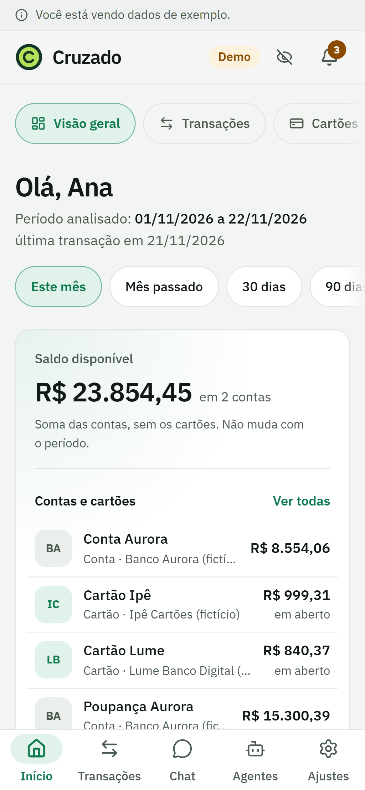
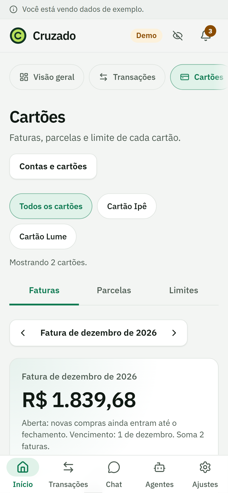
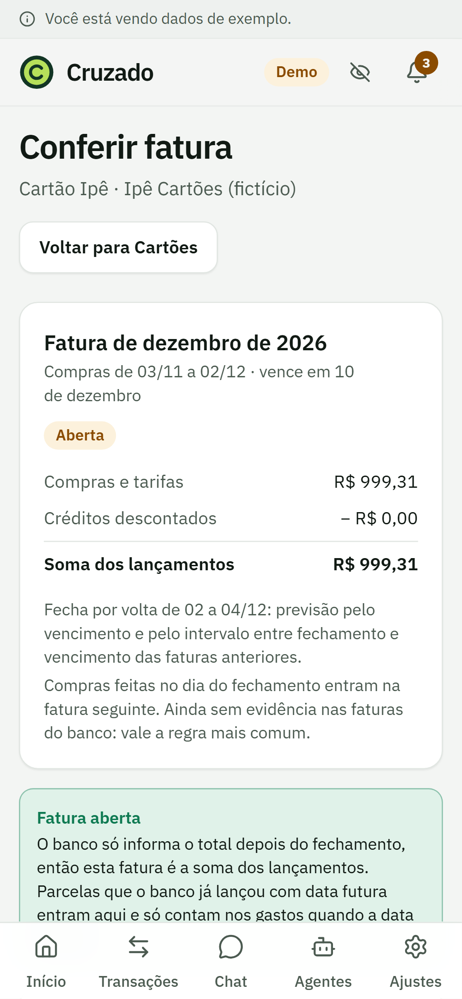
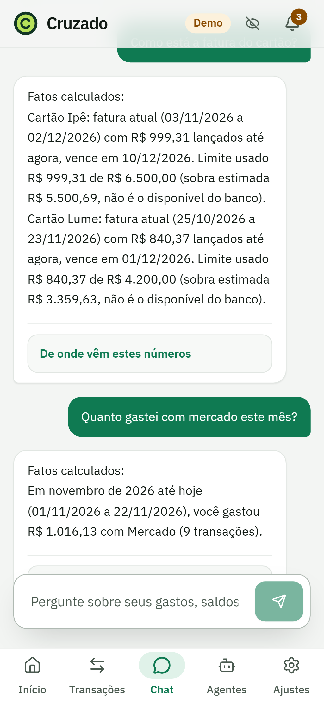
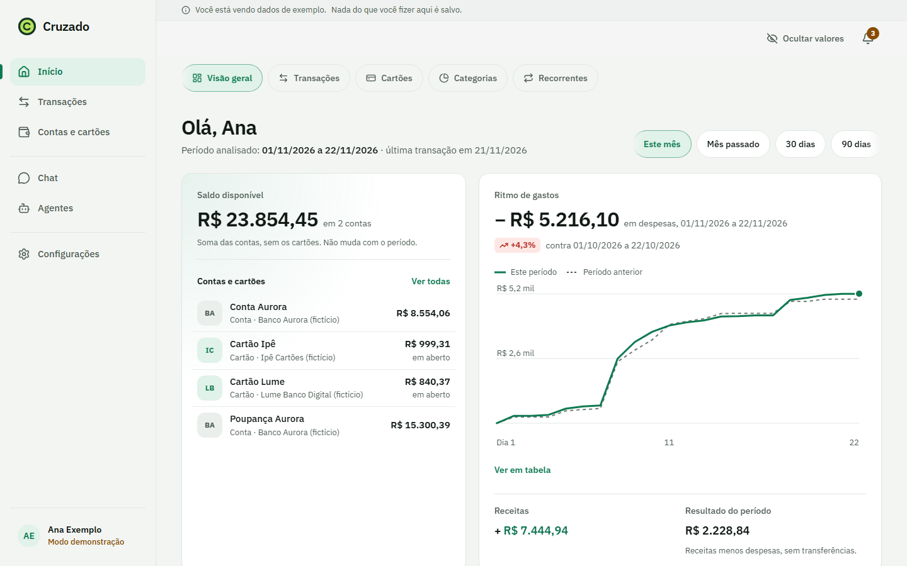
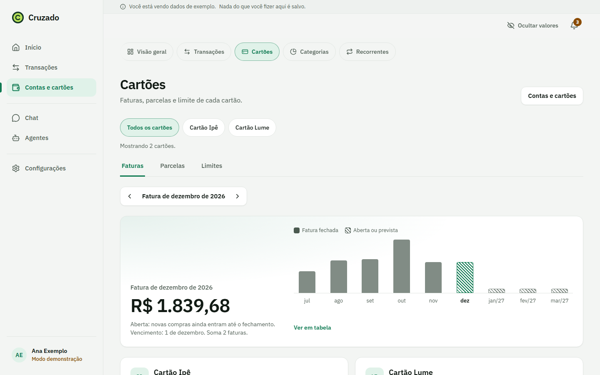
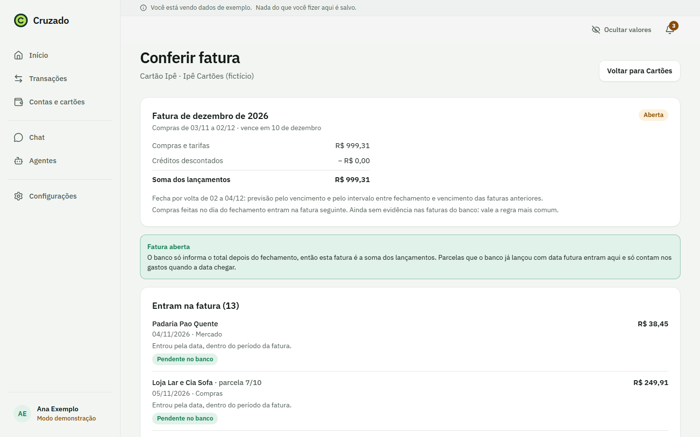
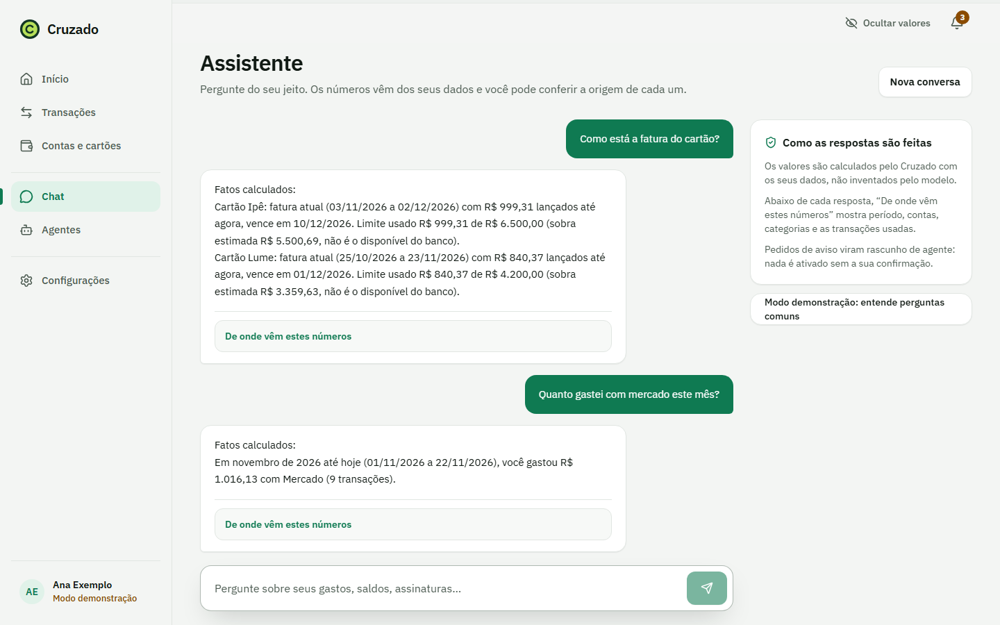
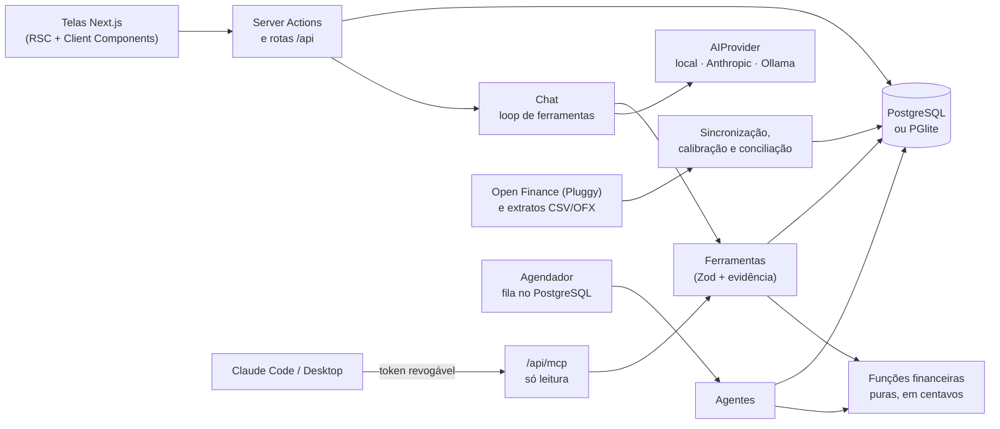

# Cruzado

Agente de finanças pessoais **somente leitura, open source e self-hosted**, feito para o celular. Ele lê contas e cartões pelo Open Finance ou por extratos, responde perguntas em português e avisa quando algo foge do normal. Todo número que mostra tem como ser conferido, até as transações que o sustentam.

**[Abrir a demonstração](https://cruzado-demo.vercel.app)** — dados inventados, sem login e sem nada salvo.

O nome vem do Cruzado, a moeda brasileira de 1986.

[English summary below](#english-summary)

<table>
  <tr>
    <td width="25%"></td>
    <td width="25%"></td>
    <td width="25%"></td>
    <td width="25%"></td>
  </tr>
  <tr>
    <td align="center">Início</td>
    <td align="center">Cartões</td>
    <td align="center">Conferir fatura</td>
    <td align="center">Chat</td>
  </tr>
</table>

<details>
<summary>As mesmas telas no computador</summary>






</details>

> Não movimenta dinheiro: sem Pix, pagamentos ou transferências. Não recomenda investimentos nem analisa crédito. Bancos reais entram só pelo Open Finance, via agregador, com permissão de leitura.

## O que ele faz

- **Painel do mês:** saldo disponível, cartões em aberto, receitas e despesas, próximas cobranças e pontos de atenção. Cada total abre a lista exata de lançamentos que o compõe.
- **Cartões e faturas:** fatura aberta e fechadas, parcelas futuras, limite e uma tela para conferir a fatura lançamento por lançamento contra o total do banco.
- **Chat em português:** "quanto gastei com mercado este mês?", "compare com o mês passado". A resposta mostra de onde vêm os números: período, filtros e links para as transações.
- **Agentes:** limite diário, resumo semanal, cobrança possivelmente duplicada e comparação mensal. Também podem ser criados por linguagem natural, sempre com confirmação.
- **Open Finance (Pluggy):** contas, saldos, transações e faturas, só leitura, sincronizados por página e retomáveis.
- **Importação de extratos:** CSV e OFX, com prévia, mapeamento de colunas e deduplicação.
- **MCP:** um token revogável deixa o Claude Code ou o Claude Desktop consultarem os dados, só para leitura.
- **Privacidade:** ocultar valores em todo o app, exportar e apagar os dados, verificação em duas etapas e auditoria.

## Destaques técnicos

- **O modelo de IA não calcula.** Ele escolhe uma ferramenta de uma lista fechada, validada com Zod, e só redige. Somas, saldos, variações e datas vêm de funções puras em TypeScript, com valores inteiros em centavos.
- **Evidência em toda resposta.** Cada ferramenta devolve período, filtros e links. A tela mostra isso independentemente do texto do modelo.
- **Faturas que batem com o banco.** O ciclo de cada cartão é calibrado pelas faturas que o banco já fechou, e uma autoconciliação classifica cada diferença pela evidência, antes de qualquer ajuste.
- **Agentes são dados, não código.** Cada regra é um objeto validado, com agendas fixas. A execução é idempotente: rodar duas vezes no mesmo período gera os mesmos alertas uma vez só.
- **Fila no próprio PostgreSQL**, com `FOR UPDATE SKIP LOCKED` e chave de deduplicação, sem serviço externo.
- **O mesmo SQL em todo lugar.** PostgreSQL em produção e PGlite (PostgreSQL em WebAssembly) nos testes de integração, no modo local sem Docker e na demonstração pública, que monta o banco em memória a cada instância.
- **Demonstração sem nenhuma credencial.** O deploy da demo recusa subir se encontrar variáveis de banco, IA ou bancos, e qualquer escrita é recusada no servidor.
- **Testes:** cerca de 720 testes de unidade e integração (Vitest, com banco real em memória) e 140 de ponta a ponta (Playwright, no celular e no computador).

## Stack

Next.js 16 (App Router, Server Actions) · React 19 · TypeScript estrito · Tailwind CSS 4 · PostgreSQL (Neon) e PGlite · Drizzle ORM · Zod 4 · Vitest · Playwright · Vercel · Pluggy (Open Finance) · Model Context Protocol · provedores de IA trocáveis (local por padrão, Anthropic ou Ollama).

## Arquitetura



Mais detalhes em [docs/ARCHITECTURE.md](docs/ARCHITECTURE.md).

## Rodar

Requisito: Node.js 22 ou mais novo.

```bash
npm ci
npm run build
npm start
```

Abra http://localhost:3000 e entre no modo demonstração. Sem `DATABASE_URL`, o app usa um PGlite em `.data/pglite` e aplica as migrações sozinho. Para desenvolvimento com recarga: `npm run dev`.

**A demonstração pública, localmente,** sem nenhuma credencial e com o banco em memória (precisa do `npm run build` antes):

```bash
node scripts/demo-instance.mjs
```

Ela abre em http://localhost:3300.

**Com Docker Compose:**

```bash
cp .env.example .env
```

Troque pelo menos o `POSTGRES_PASSWORD` (em produção, também `APP_URL=https://...`) e rode `docker compose up -d --build`. Sobe o PostgreSQL 17 e o app na porta 3000.

**Testes:**

```bash
npm run lint
npm run typecheck
npm test
npm run test:e2e
```

O `test:e2e` precisa do `npm run build` antes e do Chromium do Playwright (`npx playwright install chromium`).

### Variáveis principais

Todas estão comentadas em [.env.example](.env.example). As principais:

| Variável | Para quê |
| --- | --- |
| `DATABASE_URL` | PostgreSQL. Vazia, usa o PGlite local |
| `APP_URL` | Endereço público. Com `https://`, o cookie de sessão fica `Secure` |
| `APP_ENCRYPTION_KEY` | 32 bytes em base64, para criptografar conexões bancárias e segredos de duas etapas |
| `AI_PROVIDER` | `mock` (padrão, nada sai do servidor), `anthropic` ou `ollama` |
| `PLUGGY_CLIENT_ID`, `PLUGGY_CLIENT_SECRET`, `PLUGGY_OWNER_USER_ID` | Open Finance ([docs/OPEN_FINANCE.md](docs/OPEN_FINANCE.md)) |
| `ALLOW_SIGNUP`, `ALLOW_DEMO` | `0` fecha o cadastro e o modo demonstração |

O provedor de IA, o MCP e o WhatsApp estão em [docs/PRIVACY.md](docs/PRIVACY.md), [docs/MCP.md](docs/MCP.md) e [docs/WHATSAPP.md](docs/WHATSAPP.md).

## Decisões e aprendizados

- **Dinheiro em centavos inteiros, datas no fuso de São Paulo.** Nenhum `float` toca em valor. Transferências e pagamento de fatura ficam fora de receitas e despesas, para a compra no cartão não contar duas vezes.
- **O app nunca declara uma fatura paga.** Ele mostra o que o banco informou e o que os lançamentos somam. Quando os dois não batem, a diferença aparece e é explicada.
- **Estorno ou pagamento se decide por evidência, não pelo texto do banco.** Um crédito é estorno quando existe a compra que ele desfaz (mesmo valor, comerciante parecido) e é pagamento quando bate com a fatura ou com os pagamentos que o banco registrou. O texto e o tipo de operação só desempatam, porque já vieram trocados.
- **O pendente fantasma.** Alguns lançamentos ficam pendentes e o banco nunca os cobra. Enquanto a fatura está aberta, eles contam. Depois que o banco fecha a fatura sem eles, saem da soma, continuam guardados e aparecem na tela de conferência.
- **Consentimento expirado parece lista vazia.** No Open Finance, um consentimento vencido devolve listas vazias, e não um erro. Por isso só uma leitura completa e limpa pode remover lançamentos.
- **Funções da Vercel têm tempo limitado.** A sincronização anda por páginas, guarda um cursor e continua de onde parou na execução seguinte.
- **Uma demo em várias instâncias.** Cada instância da Vercel monta sua própria cópia em memória. Com IDs aleatórios, um link feito por uma instância dava "página não encontrada" em outra. Os IDs da demo agora vêm de uma semente do dia, e um teste de ponta a ponta clica em cada link com ID em duas instâncias diferentes.
- **A página 404 também responde 200.** No Next.js, com streaming, o `notFound()` chega com status 200. Os testes conferem o texto próprio de cada tela, e não o status.
- **Menos dependências, mais controle.** Autenticação própria (sessões no banco, token com hash, `scrypt`), migrações SQL escritas à mão e gráficos em SVG próprios, com tabela alternativa e padrões que não dependem só de cor.
- **Leitor determinístico antes de IA.** O provedor padrão entende as perguntas comuns sem enviar nada para fora. Um modelo externo é opcional e pede consentimento de cada usuário.

Mais em [docs/DECISIONS.md](docs/DECISIONS.md).

## Estado

| Parte | Estado |
| --- | --- |
| Painel, cartões, faturas, chat, agentes, importação e MCP | Funcionando |
| Open Finance para o dono da instância | Funcionando, em uso pessoal |
| Demonstração pública | No ar, sem credenciais |
| **Isolamento por usuário para convidados** (auditoria de cada consulta, testes de que A nunca vê B, RLS no banco) | **Em andamento** ([docs/ROADMAP.md](docs/ROADMAP.md)) |
| Provedores Anthropic e Ollama, Docker Compose | Escritos, não testados contra serviço real |

Segurança e privacidade: [docs/SECURITY.md](docs/SECURITY.md) e [docs/PRIVACY.md](docs/PRIVACY.md). Próximos passos: [docs/ROADMAP.md](docs/ROADMAP.md).

## Autor

**Vinicius Silva**, estudante de Sistemas de Informação. [LinkedIn](https://www.linkedin.com/in/viinicius-silva) · [GitHub](https://github.com/viinisilva)

<sub>Desenvolvido com apoio do Claude Code, com testes e revisão em cada etapa.</sub>

## Licença

Apache-2.0. Veja [LICENSE](LICENSE), [NOTICE.md](NOTICE.md) e [THIRD_PARTY_LICENSES.md](THIRD_PARTY_LICENSES.md).

---

## English summary

**Cruzado** is a read-only, self-hosted personal finance agent for Brazil, built mobile-first. It reads accounts and credit cards through Open Finance (Pluggy) or bank statements (CSV/OFX), answers questions in Portuguese and raises alerts. Every number links back to the transactions behind it.

**[Try the demo](https://cruzado-demo.vercel.app)** — invented data, no login, nothing is saved.

- **The AI model never does math.** It picks a Zod-validated tool and writes the answer; totals come from pure TypeScript functions using integer cents, and each answer carries its evidence (period, filters, links).
- **Card bills that match the bank:** billing cycles are calibrated from the bank's closed bills, and a reconciliation step explains each difference.
- **Agents are data, not code:** validated rules, fixed schedules, idempotent runs, and a job queue inside PostgreSQL (`FOR UPDATE SKIP LOCKED`).
- **Same SQL everywhere:** PostgreSQL in production, PGlite (Postgres in WebAssembly) for integration tests, local runs and the public demo.
- **Tested:** about 720 unit and integration tests (Vitest, real in-memory database) and 140 end-to-end tests (Playwright, phone and desktop).
- **Stack:** Next.js 16, React 19, TypeScript, Tailwind CSS 4, PostgreSQL/Neon, Drizzle, Zod, Vercel, Model Context Protocol.
- **Status:** working for a single owner. Per-user isolation for invited users is in progress.

**Author:** Vinicius Silva, Information Systems student. [LinkedIn](https://www.linkedin.com/in/viinicius-silva) · [GitHub](https://github.com/viinisilva)

Licensed under Apache-2.0.
