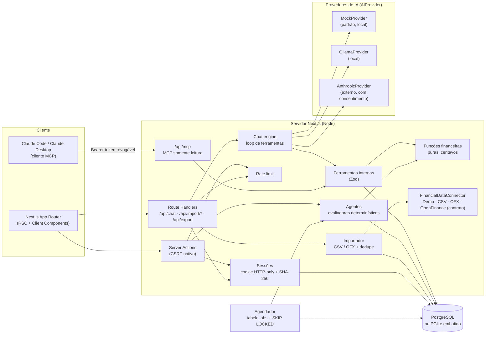

# Arquitetura

## Visão geral

## Princípios

1. **O LLM não calcula.** Ele interpreta a intenção, escolhe uma ferramenta da lista fechada (`src/lib/tools`), recebe o resultado e redige a resposta. Toda soma, variação, saldo e data prevista vem de `src/lib/finance/core.ts`, com valores inteiros em centavos.
2. **Evidência anexada a toda resposta.** Cada ferramenta devolve `evidence` (período, filtros, notas e links para transações/categorias). A UI mostra isso em "De onde vêm estes números", independentemente do texto do modelo.
3. **Agentes são dados, não código.** Um agente é um `AgentRule` validado por Zod (`src/lib/agents/rule.ts`). Não existe SQL, código ou cron livre; agendas são presets (`continuous`, `daily`, `weekly_monday`, `monthly_first`). Os avaliadores (`evaluators.ts`) são funções puras.
4. **Escopo por usuário no servidor.** `src/lib/data/repo.ts` filtra tudo por `userId`; ids vindos do cliente ou do modelo passam por `ownedIds` antes de virar filtro.
5. **Somente leitura em relação a instituições.** Não há métodos de pagamento, Pix ou transferência em nenhuma interface (conectores, ferramentas, MCP).

## Módulos

| Caminho | Responsabilidade |
| --- | --- |
| `src/db/schema.ts`, `drizzle/*.sql` | Modelo de dados (Drizzle) e migrations versionadas |
| `src/db/connection.ts`, `src/db/migrate.ts` | Conexão (PostgreSQL via `DATABASE_URL` ou PGlite) e aplicação de migrations |
| `src/lib/finance/` | Cálculos determinísticos, períodos e recorrências |
| `src/lib/tools/` | Ferramentas do chat (contratos Zod + evidência) |
| `src/lib/ai/` | `AIProvider`: Mock, Ollama, Anthropic e o parser de intenções do modo demo |
| `src/lib/chat/engine.ts` | Loop de ferramentas, prompt de sistema, aviso regulatório, persistência |
| `src/lib/agents/` | Regras, avaliadores, ciclo de vida, execução idempotente e fila |
| `src/lib/connectors/` | `FinancialDataConnector` e parsers CSV/OFX |
| `src/lib/importer.ts` | Prévia, confirmação e deduplicação de extratos |
| `src/lib/mcp/` | Servidor MCP (somente leitura) e tokens |
| `src/lib/auth/` | Senhas (scrypt), sessões, criptografia de segredos (AES-256-GCM) |
| `src/app/` | Páginas, Server Actions e Route Handlers |

## Fluxos

### Pergunta no chat

1. `POST /api/chat` → origem verificada, sessão, rate limit, consentimento (se provedor externo).
2. `answer()` monta o prompt de sistema (data de hoje, nomes de contas e categorias) e o histórico curto só com texto.
3. O provedor devolve chamadas de ferramenta → `runTool` valida a entrada com Zod e executa com `userId` do servidor.
4. Resultado volta ao provedor como dado não confiável; o provedor redige a resposta.
5. Mensagem salva com `evidence` (período, filtros, fontes) e aviso regulatório quando a pergunta envolve investimento, crédito ou dívida.

### Agentes

- `enqueueDueAgents` cria jobs com chave de deduplicação `agent:<regra>:<período>[:slot]` (`ON CONFLICT DO NOTHING`).
- `processJobs` reivindica com `FOR UPDATE SKIP LOCKED`, executa `runAgent` e reenfileira com backoff em caso de erro (até 3 tentativas).
- `runAgent` faz upsert em `agent_runs (rule_id, period_key)` e insere notificações com `dedupe_key` única por usuário: executar N vezes no mesmo período produz os mesmos alertas uma única vez.
- Importações e lançamentos manuais disparam imediatamente os agentes `daily_spend_limit` e `possible_duplicate`.

### Importação

`preview` (sem escrita) → usuário ajusta o mapeamento e confere → `commit` insere com `ON CONFLICT (user_id, dedupe_key) DO NOTHING`. A chave é o FITID (OFX) ou um hash de conta+data+valor+estabelecimento+ocorrência no arquivo (CSV). Só metadados e o SHA-256 do arquivo ficam guardados.
